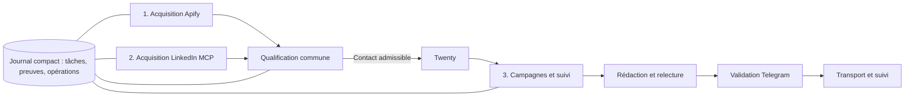

> Référence datée. Pour les règles de mailing applicables depuis le 6 novembre 2026, lire [WORKFLOW_OPERATIONS.md](WORKFLOW_OPERATIONS.md). Les anciennes règles de mailing sont retirées.

# Refonte Enrich — trois workflows et campagnes orientées rendez-vous

Date : 5 novembre 2026. Entretien `grill-with-docs` clôturé par la validation explicite Q30 (« je valide »). Cadrage accepté et [plan d'implémentation préparé](PLAN_IMPLEMENTATION_REFONTE_2026-11-05.md). Seules les décisions, le vocabulaire et le plan sont documentés à ce stade. Aucune base supprimée, aucun service activé, aucun email envoyé par cette intervention.

## Décisions confirmées dans la conversation

| Question | Choix utilisateur |
|---|---|
| Q1 — Objectif | Obtenir davantage de rendez-vous ; Q9 précise que toute prise de rendez-vous compte |
| Q2 — Découpage | 1. Acquisition Apify ; 2. Acquisition LinkedIn MCP ; 3. Campagnes et suivi |
| Q3 — Stockage | Supprimer le sas séparé ; conserver un journal technique compact |
| Q4 — Rédaction | Rédaction encadrée + relecture indépendante + validation Telegram |
| Q5 — Premier périmètre | Commencer par les entreprises déjà dans Twenty ; Q14 étend le pilote à tous les secteurs |
| Q6 — Appel à réponse | Viser la prise de rendez-vous ; proposer directement un échange, formulation et bénéfice à préciser |
| Q7 — Relances | Conserver un seul email initial pour le premier pilote |
| Q8 — Argumentation | Mobiliser les biais cognitifs et la psychologie de décision dans les messages |
| Q9 — Succès commercial | « tout rdv est bon a prendre » : aucune qualification commerciale préalable exigée pour compter un rendez-vous |
| Q10 — Modalité | Lien de réservation dès l'email ; téléphone/Meet envisagés initialement, remplacés par Cal Video en Q15 |
| Q11 — Durée initiale | 15 minutes choisies initialement, remplacées par 30 minutes en Q15 |
| Q12 — Angles | Temps perdu qui s'accumule et avance concurrentielle |
| Q13 — Lien | Lien Cal.com fourni par l'utilisateur ; page vérifiée en lecture seule |
| Q14 — Secteurs | Tous les secteurs déjà présents dans Twenty |
| Q15 — Configuration retenue | Utiliser le lien actuel et annoncer 30 minutes avec Cal Video |
| Q16 — Texte et variantes | Texte C accepté ; préparer plusieurs variantes pour comparer leur efficacité |
| Q17 — Premier lot | Jusqu'à 20 contacts admissibles au total, tous secteurs, avec validation Telegram individuelle |
| Q18 — Retour éditorial | Variantes jugées peu impactantes ; demande d'un peu de provocation. Les nouvelles accroches et la comparaison C/B ne sont pas validées |
| Recherche après Q18 | Recherche Internet via Firecrawl et utilisation d'un humanizer demandées ; textes H1/H2/H3 proposés, pas encore validés |
| Validation éditoriale suivante | « je valide 2 et 5 » : variantes V2 « construire votre avance » et V5 « au-delà des chatbots », issues du texte utilisateur ; corps et fin commune figés dans le dossier éditorial |
| Q19 — Personnalisation pilote | Recommandation acceptée : figer V2/V5, remplacer seulement civilité, nom et entreprise ; personnalisation factuelle envisagée ensuite |
| Q20 — Interlocuteur | Choisir le contact le mieux placé parmi les contacts disponibles, selon son rôle et sa pertinence ; pas de liste fermée de fonctions |
| Q21 — Rendez-vous | Suivi et confirmation manuels par l'utilisateur ; pas de synchronisation automatique Cal.com retenue pour ce pilote |
| Q22 — Acquisition | Brief déclenché explicitement, puis exécution autonome dans ses limites |
| Q23 — Coûts | Plafonds stricts par campagne et par fournisseur ; arrêt avant dépassement |
| Q24 — Migration | Recommandation acceptée : pause planifiée des écritures des trois workflows, sauvegarde restaurable, conservation des attentes et contrôles avant reprise ; date non fixée |
| Q25 — Attente Telegram | Recommandation acceptée : brouillon conservé en attente, tâches indépendantes poursuivies et éligibilité revérifiée avant un éventuel envoi approuvé ; silence sans valeur d'approbation |
| Q26 — Comparaison | Recommandation acceptée : jusqu'à 10 destinataires V2 et 10 V5, affectation aléatoire, 14 jours après chaque envoi ; résultat exploratoire sur messages complets |
| Q27 — Acquisition suivante | Recommandation acceptée : Maroc, tous secteurs, objectif de 20 nouveaux contacts admissibles au total entre les deux acquisitions ; lot distinct du pilote Twenty |
| Q28 — Pilotage | Recommandation acceptée : Telegram pour briefs, états et alertes ; commandes conservées pour maintenance |
| Q29 — Priorité | Recommandation acceptée : corriger l'amplification du journal et préparer la migration du stockage avant la séparation des workflows et l'intégration V2/V5 |
| Q30 — Cadrage final | « je valide » : cadrage complet confirmé ; entretien clôturé et préparation du plan d'implémentation engagée |

Architecture cible consignée dans [ADR-0004](adr/0004-trois-workflows-et-journal-compact.md). Les recommandations ci-dessous détaillent cette cible ; les modalités non encore choisies ne sont pas des décisions acquises.

## Diagnostic mesuré

Mesures au moment de l'audit ; Go et Mo décimaux. Le dépôt contient déjà de nombreuses modifications locales antérieures à cette intervention.

| Élément | Volume | Lecture |
|---|---:|---|
| Dossier complet, allocation disque | 10,471 Go | Taille apparente : 10,448 Go |
| `bdd/workflow/staging.sqlite` | 4,769 Go | Sas actuel |
| `bdd/workflow/staging.sqlite.journal.sqlite` | 4,713 Go | Historique et état du workflow |
| Table `outreach_journal_outbox` | 4,593 Go | 1 173 011 événements, tous marqués exportés |
| Table `journal_events` | 4,598 Go | 1 173 011 événements |
| Table `staging_leads` | 51,76 Mo | 37 343 candidats `PENDING` |
| Sauvegardes | 503,88 Mo | À préserver selon leur utilité de restauration |
| Sources | 92,06 Mo | À conserver |
| Rapports | 3,19 Mo | Ne sont pas la cause principale |

Les volumes des tables sont inclus dans ceux des bases. Ils ne doivent pas être additionnés aux fichiers. SQLite indique zéro page libre dans le sas et seulement 655 360 octets libres dans le journal : compacter sans traiter les données redondantes aurait peu d'effet.

La chaîne d'amplification est vérifiable dans le code :

1. `scripts/direct_enrichment.py:200` remet `is_enriched_linkedin=0` sur tous les contacts sans URL, y compris ceux déjà à zéro, lors de l'initialisation.
2. `scripts/outreach_journal.py:71` capture chaque UPDATE, sans condition de changement effectif.
3. `scripts/outreach_journal.py:27` construit un snapshot de toutes les colonnes.
4. `scripts/outreach_journal.py:139` copie l'événement vers le journal, puis marque l'outbox exportée sans retirer la copie.

L'historique contient 1 096 900 événements de type `contact`. Ce constat est cohérent avec l'amplification ; l'audit n'attribue pas tous les événements à une seule instruction. Il n'a pas comparé octet par octet les deux historiques.

Environ 4,59 Go correspondent donc à un potentiel de récupération sur la copie outbox, sous réserve de comparaison exacte et de reconstruction/compaction. Ce volume n'est ni déjà libéré ni une garantie de résultat. Une opération FullEnrich est encore `SUBMITTED` ; les attentes LinkedIn et les candidats doivent survivre à toute migration.

Autres frictions vérifiées :

- Le point d'entrée `scripts/workflow.py` regroupe préparation, rédaction, envoi et suivi ; son contrôle global de disponibilité dépend aussi de services inutiles à certaines tâches.
- `scripts/import_apify_companies.py` importe un export local de sociétés et crée un journal par lot. Ce n'est pas encore un orchestrateur générique d'Actors.
- `scripts/prompt_engine.py:107` n'autorise que `pattern_id` pour un email initial. Une instruction de réécriture ne peut pas réellement réécrire les phrases.
- Les deux skills rédactionnels sont intégralement chargés pour ce simple choix de modèle. Les agents doivent être réservés aux décisions qui bénéficient d'une analyse.
- L'ancien glossaire admettait encore catch-all. Il est réaligné sur la règle active de `agents.md` et `crm_transfer.py:43` : adresse professionnelle et `VALID` récent. Ce changement documentaire n'élargit pas l'admission.

## Architecture cible

Trois entrées opérationnelles indépendantes, mais des services de qualification et un état partagés. Un workflow peut être arrêté ou repris sans rendre les deux autres inutilisables. Une panne Thunderbird ne doit pas interdire l'acquisition ; un LinkedIn indisponible ne doit pas empêcher une campagne portant sur des contacts déjà admissibles.

Le journal compact reste une base technique, pas une seconde copie complète du CRM. Il conserve une file minimale des candidats en attente, leurs références sources, les identités stables, les opérations et leurs résultats, les versions approuvées, les exclusions et les preuves exactes compressées une seule fois. La disparition du fichier sas n'implique pas la disparition de la fonction d'attente.

### Workflow 1 — Acquisition Apify

**Usage :** identifier des entreprises selon un secteur et une zone, puis trouver les contacts utiles à une campagne choisie.

Brief de cible → Actor configuré → résultats paginés → identité/dédoublonnage → qualification → entreprise ou personne admissible dans Twenty.

- Réutiliser comme point de départ le connecteur `compass/crawler-google-places` cité dans l'import existant ; vérifier ensuite son contrat, ses coûts et sa pertinence pour la cible choisie. Aucun Actor lancé pendant cet audit.
- L'Actor est un fournisseur d'observations, pas une preuve de délivrabilité. Une adresse générique d'entreprise ne devient pas l'adresse nominative de son dirigeant.
- Conserver version d'entrée, identifiant du run et du dataset, provenance des résultats et progression de lecture. Lire par pages et reprendre après interruption.
- Sur cette installation locale, commencer par une interrogation de statut à cadence espacée ; un webhook devient pertinent si un point de réception fiable est disponible. Les notifications peuvent arriver plusieurs fois : le même résultat doit être appliqué une seule fois.
- Ne pas relancer un Actor après un timeout de soumission sans avoir réconcilié l'opération. Définir le budget de campagne avant d'activer les nouveaux appels payants.
- Normalisation, règles exactes et import sont du code. Un agent intervient pour une ambiguïté d'identité ou une qualification contextuelle.
- Une société sans décideur confirmé peut exister dans le CRM comme société ; elle ne devient pas automatiquement un destinataire. Un complément LinkedIn passe par la file commune du workflow 2.

Sortie : entreprises identifiées, contacts admissibles et attentes explicites. Indicateurs : coût par entreprise pertinente, coût par contact qualifié, taux de doublons et rendement d'admission.

### Workflow 2 — Acquisition LinkedIn MCP

**Usage :** qualifier un décideur ou compléter un compte prioritaire avec plus de précision.

Cible personne/entreprise → recherche MCP → profil et lien professionnel confirmés → coordonnées → qualification → Twenty.

- Garder un seul worker LinkedIn global, y compris lorsque plusieurs campagnes demandent des recherches. Appels séquentiels à `search_people` et `get_person_profile`.
- Réutiliser le contrat JSON existant. Une homonymie non résolue attend une revue ; un résultat bloqué n'est pas un profil absent.
- Si une adresse professionnelle source est exploitable, la vérifier avant de payer un nouvel enrichissement. FullEnrich reste réservé à une adresse absente/rejetée avec URL personnelle confirmée ; vérifier ensuite l'adresse obtenue avec No2Bounce.
- L'admission du parcours mailing requiert `VALID` récent sur la même adresse. LinkedIn n'est pas obligatoire lorsque l'identité et l'adresse satisfont déjà les règles d'admission.
- Le worker renvoie des faits avec leur source. Le parent valide, journalise et applique les mutations ; l'agent ne crée pas directement les personnes CRM.
- Construire un dossier rédactionnel court : rôle, entreprise, faits utiles, sources, incertitudes. Ne transmettre au rédacteur que les faits nécessaires à son angle.

Sortie : contacts confirmés et dossiers factuels ; états distincts pour ambiguïté, accès bloqué et absence de coordonnées. Indicateurs : temps par contact, coût par contact qualifié et contribution aux rendez-vous.

### Workflow 3 — Campagnes et suivi

**Usage :** transformer les contacts admissibles à l'envoi en conversations et en rendez-vous, sans condition de qualification commerciale préalable pour compter ces rendez-vous.

Brief de campagne → sélection CRM → contrôle d'éligibilité → rédaction → critique indépendante → version figée → Telegram → envoi → suivi → résultats.

- Une campagne possède une cible, une offre, un objectif, un propriétaire, une politique de cadence et un historique de versions. Ne pas dupliquer une campagne pour chaque source d'acquisition.
- Vérifier de nouveau l'éligibilité au moment d'envoyer : exclusions, réponse déjà reçue, fraîcheur de vérification, version approuvée, incident et cadence.
- Le rédacteur produit un vrai objet et un vrai corps, dans une structure autorisée. Le critique vérifie pertinence, vérité des affirmations et facilité de réponse ; les contrôles déterministes portent les contraintes vérifiables.
- Une réécriture révoque l'approbation antérieure. Conserver destinataire, objet, corps et version de signature afin que l'aperçu approuvé corresponde au message expédié.
- Le transport reste sous contrôle du programme, avec une seule coordination des envois entre campagnes. Un résultat d'envoi inconnu doit être réconcilié avant toute nouvelle tentative.
- Conserver le suivi entrant existant : classification structurée, extrait exact, identité rattachée par le parent. Distinguer intérêt, refus, désinscription, réponse automatique et rebond.
- Le premier pilote conserve un seul email initial, sans relance automatique, conformément au choix Q7. Une réponse humaine peut donner lieu à un échange approuvé pour organiser le rendez-vous ; elle n'est pas une relance de prospection sans réponse.
- L'email contient le lien Cal.com existant et annonce 30 minutes en visioconférence sur Cal Video, conformément à Q15. Téléphone, Google Meet et durée de 15 minutes ne sont plus la configuration retenue pour ce pilote.
- L'objectif de simplicité est de collecter seulement les renseignements utiles à l'organisation, sans questionnaire de qualification commerciale imposé par le workflow. Le formulaire complet de Cal.com n'a pas été soumis ni modifié pendant l'audit.
- Une réservation confirmée compte comme rendez-vous obtenu. Un clic sur le lien ou un message « intéressé » ne suffit pas. Mettre à jour le même rendez-vous en cas de déplacement ; enregistrer séparément annulation, absence et échange tenu.
- Rapprocher la réservation avec le contact et la campagne par un identifiant stable. Q21 confie à l'utilisateur la confirmation et le suivi manuels des rendez-vous ; aucune synchronisation automatique Cal.com n'est retenue pour ce pilote.

## Sous-agents par type de tâche

| Spécialiste | Mission et sortie | Limite |
|---|---|---|
| Qualification | Pertinence, identité, segment proposé, sources et inconnues | Ne fusionne pas sur un nom seul |
| Recherche LinkedIn | Profil confirmé et extraction structurée | Un seul worker MCP, aucune interaction sociale |
| Stratégie de campagne | Brief, angle psychologique proposé, contexte et critères de sélection | Une intervention par campagne ; hypothèse de persuasion distinguée d'un fait sur le prospect |
| Rédaction | Objet, corps, levier choisi et justification fondée sur le dossier | Aucun accès à l'envoi ou à la mutation CRM |
| Critique éditoriale | Acceptation ou motifs précis : vérité, pression, clarté du lien et appel à l'action | Indépendant du rédacteur ; aucun changement silencieux après validation |
| Suivi des réponses | Classe, preuve textuelle, besoin de réponse | Classification proposée ; parent responsable des actions |
| Analyse | Résultats agrégés et prochaine expérience proposée | Aucun changement automatique de campagne |

L'orchestrateur est du code : réservation des tâches, délais, transitions et opérations. Les appels Apify/FullEnrich/No2Bounce, l'import CRM, le dédoublonnage exact et le transport sont des adaptateurs déterministes. Il n'est pas utile de créer un agent pour chaque appel API.

Chaque tâche possède un identifiant, une version d'entrée, un périmètre de droits, un schéma de sortie, une échéance et un statut de reprise. Les agents travaillent sur des dossiers indépendants ; les mutations critiques restent sérialisées. Le parallélisme de rédaction sera borné selon le budget et la capacité de revue, sans multiplier les workers LinkedIn.

## Proposition éditoriale

Les références éditoriales courantes sont V2 « construire votre avance » et V5 « au-delà des chatbots », explicitement validées par l'utilisateur. Leurs objets, corps et fin commune exacts sont dans [Recherche Firecrawl et réécriture Humanizer](COLD_EMAIL_RESEARCH_2026-11-05.md), avec les sources et les séries historiques H et L. Cette validation n'active pas une campagne ; les versions ci-dessous conservent l'historique de l'entretien.

Diagnostic éditorial : les cinq textes actuels parlent surtout de progrès de l'IA, de temps et de concurrence. Aucun résultat de campagne analysé ici ne permet de chiffrer un gain lié à leur réécriture.

Orientation confirmée : utiliser la psychologie de décision, avec les deux angles retenus en Q12, temps perdu et avance concurrentielle. Le message mène directement à un rendez-vous de 30 minutes sur Cal Video via le lien existant. La piste de test préalable et la durée de 15 minutes ne sont plus proposées. Conserver la civilité confirmée, le nom, une seule question, la phrase de conclusion demandée et « Cordialement, ». Le texte C a été accepté comme référence éditoriale en Q16 ; les nouvelles variantes A et B ont ensuite été rejetées en Q18 comme peu impactantes. L'utilisateur demande un peu de provocation. La sélection finale du pilote a depuis été confirmée : V2 et V5 remplacent les propositions historiques ci-dessous. Chaque version adressée à un destinataire reste soumise à Telegram avant un éventuel envoi autorisé.

| Levier | Application au message | Contrôle éditorial |
|---|---|---|
| Cadrage par le coût du statu quo, inspiré de l'aversion à la perte | Rendre perceptible le temps absorbé par une tâche répétitive | Ne pas chiffrer une perte ni attribuer un processus non observé au prospect |
| Avance concurrentielle possible | Relier le temps récupéré à la capacité d'agir | Ne pas affirmer qu'un concurrent précis a adopté l'IA ou obtenu un résultat inconnu |
| Effort de réservation limité | Un seul lien, durée explicite, formulaire aussi court que possible | Aucune réservation automatique ni fausse rareté de créneaux |
| Preuve sociale, seulement si disponible | Citer une référence pertinente | Référence vérifiable et autorisée ; aucun client ou résultat inventé |

L'aversion à la perte est notamment étudiée dans les travaux de Kahneman et Tversky sur les décisions sous risque. Le modèle de Fogg met en relation motivation, capacité d'agir et sollicitation. Leur application à ces emails constitue une hypothèse de conception à tester, sans gain de conversion garanti. Sources primaires : [Prospect Theory, 1979](https://web.mit.edu/curhan/www/docs/Articles/15341_Readings/Behavioral_Decision_Theory/Kahneman_Tversky_1979_Prospect_theory.pdf), [Fogg Behavior Model](https://www.behaviormodel.org/).

La civilité ci-dessous est illustrative. Employer Madame si confirmé ; sinon revue. Thunderbird ajoute une seule signature HTML après le corps approuvé. `{LIEN_RESERVATION}` désigne le lien fourni ci-dessous : le véritable URL devra être inséré avant l'approbation du corps. Trois versions sont documentées ; deux seulement sont proposées pour le premier pilote. Les trois versions ont désormais le même objet pour isoler l'effet de l'accroche.

### A — Temps perdu, proposition rejetée en Q18

Objet : **du temps pour avancer**

> Bonjour Monsieur {Nom de famille},
>
> Quelques minutes consacrées à une tâche répétitive passent facilement inaperçues. Accumulées chaque semaine, elles peuvent prendre une vraie place dans l'activité. L'IA offre des pistes pour récupérer une partie de ce temps.
>
> Seriez-vous disponible pour en parler 30 minutes sur Cal Video ? Choisissez votre créneau : {LIEN_RESERVATION}
>
> Chez Contexte Lab, nous accompagnons les entreprises pour faire de l'IA un vrai levier de croissance.
>
> Cordialement,

### B — Avance concurrentielle, proposition rejetée en Q18

Objet : **du temps pour avancer**

> Bonjour Monsieur {Nom de famille},
>
> Avec l'IA, l'avantage peut venir de la façon d'utiliser des outils accessibles à tous. Une tâche allégée peut laisser davantage de temps pour agir, mieux servir ses clients et faire avancer l'activité.
>
> Seriez-vous disponible pour en parler 30 minutes sur Cal Video ? Choisissez votre créneau : {LIEN_RESERVATION}
>
> Chez Contexte Lab, nous accompagnons les entreprises pour faire de l'IA un vrai levier de croissance.
>
> Cordialement,

### C — Référence acceptée : combinaison des deux angles retenus

Objet : **du temps pour avancer**

> Bonjour Monsieur {Nom de famille},
>
> Les tâches répétitives prennent du temps qui pourrait servir à développer l'activité. Semaine après semaine, ce temps s'accumule. Avec l'IA, en récupérer une partie peut devenir un avantage concurrentiel.
>
> Seriez-vous disponible pour en parler 30 minutes sur Cal Video ? Choisissez votre créneau : {LIEN_RESERVATION}
>
> Chez Contexte Lab, nous accompagnons les entreprises pour faire de l'IA un vrai levier de croissance.
>
> Cordialement,

Le texte C combine les choix Q12 et constitue la référence acceptée en Q16. La proposition de comparaison C/B n'est pas validée à la suite du refus Q18. A et B restent documentées comme versions rejetées et ne doivent pas être utilisées dans le pilote. Aucun catalogue de prestations ni cas client chiffré n'a été établi par l'audit local. Les leviers sont des hypothèses éditoriales, pas une description psychologique individuelle des prospects.

Hors expérience, la rédaction encadrée reste la cible. Pendant une comparaison, les accroches et éléments communs seront figés par version ; l'agent critique peut refuser un texte inadapté mais ne le transforme pas silencieusement en une autre variante.

### Révision après Q18 — Provocation modérée, à examiner

La provocation vise le coût des habitudes et de l'attente. Elle n'attribue pas au prospect une mauvaise gestion, un retard établi ou des pertes chiffrées. Les trois accroches suivantes sont nouvelles et non approuvées. Objet commun : « du temps pour avancer ». Salutation, appel à réservation, lien, conclusion et signature restent ceux de C. Une seule accroche sera utilisée par email ; ne pas les cumuler.

**P1 — Le coût des habitudes**

> « On a toujours fait comme ça » peut devenir une façon très coûteuse de travailler. Les tâches répétitives continuent de prendre du temps, même lorsqu'on a cessé de les remettre en question. L'IA mérite au moins qu'on teste l'alternative.

**P2 — L'avance ne vient pas des outils**

> Avoir les mêmes outils que ses concurrents ne donne aucune avance. Savoir quoi en faire peut en créer une. Avec l'IA, attendre que tout soit évident risque surtout de laisser l'apprentissage aux autres.

**P3 — La facture invisible**

> Le temps perdu a un avantage : il n'envoie jamais de facture. Il se cache dans les petites tâches qu'on répète chaque semaine. C'est précisément là qu'un usage bien choisi de l'IA peut valoir la peine d'être testé.

Recommandation éditoriale à examiner : P1 et P2, qui déclinent les deux angles retenus en Q12 avec un ton plus incisif. P3 propose une alternative plus imagée. Le protocole exploratoire de 20 contacts maximum reste proposé, mais aucun couple de variantes n'est sélectionné sans retour utilisateur. Les refus précédents restent conservés afin d'éviter leur réutilisation par un agent.

## Réservation et périmètre du pilote

Lien fourni par l'utilisateur :

https://cal.com/chahid-naoufel-hd6ljk/30min?utm_source=contextelab&utm_medium=site&utm_campaign=autre&utm_content=%2Fcontact&overlayCalendar=true

La page publique a été lue le 5 novembre 2026 : titre « Rendez-vous de 30 min », durée 30m et modalité Cal Video. L'utilisateur choisit explicitement de conserver cette configuration en Q15, après vérification. Aucun rendez-vous créé et aucun paramètre de calendrier modifié. Le fuseau affiché par l'outil de lecture ne prouve pas le fuseau de l'agenda du propriétaire.

Les paramètres actuels indiquent `utm_medium=site` et `utm_campaign=autre`. Une attribution propre aux emails pourra être proposée ultérieurement ; conserver l'URL fournie tant qu'une variante n'a pas été vérifiée. Un clic sur ce lien ne prouve pas une réservation ; le suivi doit recevoir ou faire confirmer l'événement de réservation.

Périmètre confirmé : entreprises déjà dans Twenty, tous secteurs. Les secteurs peuvent servir à adapter le texte et à analyser les résultats ; aucun secteur n'est exclu du pilote par défaut. Les règles d'identité, de délivrabilité et d'exclusion d'envoi continuent de déterminer les contacts admissibles.

Q17 fixe un plafond de 20 contacts admissibles pour ce premier lot, toutes variantes confondues. Si moins de 20 contacts sont admissibles, conserver le nombre réellement disponible sans assouplir la qualification de l'adresse ni augmenter le lot automatiquement. Ce plafond pilote ne modifie pas les limites générales des fournisseurs.

La recherche locale a examiné les exports Apify du 30 octobre et les exports d'emails/suppressions du 4 novembre. Après les trois suppressions documentées : 292 entreprises issues de ces imports, réparties en services (82), industrie (70), BTP (59), distribution B2B (40), comptabilité/audit/fiduciaires (41). Parmi elles, 21 entreprises portent 153 emails sources dans le CSV examiné. Ces chiffres sont historiques et ne constituent ni un état CRM actuel ni un nombre de destinataires admissibles : `outputs/company-emails-20261104/summary.json` indique `deliverability_verified=false`.

Sources de rapprochement : `outputs/apify-mohammedia-20261030/crm-import.json`, `outputs/apify-mohammedia-20261030-suite/crm-import.json`, `outputs/apify-mohammedia-20261030-reste/crm-import.json`, `outputs/company-emails-20261104/entreprises-emails.csv`, `outputs/company-removals-20261104/summary.json`. Aucun contact réel n'est reproduit dans ce document.

## Mesurer l'efficacité

Objectif confirmé par Q9 : davantage de rendez-vous obtenus, sans condition de qualification commerciale préalable. Un rendez-vous obtenu dispose d'un créneau confirmé ; le nombre de rendez-vous tenus est suivi séparément. Ne pas transformer automatiquement tous les rendez-vous en opportunités commerciales qualifiées.

Suivre par campagne, segment et source : candidats, contacts qualifiés, brouillons approuvés, envois confirmés, réponses humaines, réponses intéressées, rendez-vous pris, rendez-vous tenus et opportunités. Un envoi confirmé n'est pas une preuve de placement en boîte de réception ; `POSITIVE` n'est pas un rendez-vous tenu.

Calculer notamment le taux de réponses intéressées et de rendez-vous obtenus sur les envois confirmés, le coût par contact admissible, le coût par rendez-vous obtenu puis tenu et le temps opérateur. Afficher les nombres bruts avec les taux, et les annulations/absences séparément. Le coût monétaire des agents n'est pas encore mesuré : `structured_agent.py` laisse `usd_cost=None`.

Comparer des variantes au sein du même segment, avec offre, cadence et source comparables. Ne pas conclure qu'un email est meilleur parce qu'un lot LinkedIn mieux ciblé surpasse un lot Apify large. Sur un petit pilote, rapporter les résultats descriptifs sans proclamer un gagnant statistique.

Vérifier l'authentification du domaine expéditeur et le traitement des exclusions avant toute hausse de cadence. Google recommande SPF, DKIM et DMARC ; ses obligations pour Gmail personnel distinguent tous les expéditeurs des expéditeurs en volume. Cela ne constitue pas un diagnostic du domaine Contexte Lab, ni une garantie de livraison. [Consignes officielles Google](https://support.google.com/a/answer/81126?hl=en).

## Comparaison proposée pour le premier lot

Statut : protocole de conception, aucune affectation de destinataire ni exécution. Q16 autorise la préparation de variantes et Q17 confirme le lot de 20 maximum. La proposition C/B ci-dessous est historique et non validée après Q18. Les références désormais validées sont V2/V5, reproduites dans le dossier éditorial ; leurs objets et corps diffèrent, donc une comparaison portera sur les messages complets et non sur la seule accroche. Les règles générales de mesure restent proposées.

**Hypothèse :** mettre l'avance concurrentielle au premier plan, dans B, pourrait susciter plus de réservations que l'accroche mixte C qui commence par le temps perdu. Le résultat peut également montrer l'inverse ou ne permettre aucune conclusion. Aucun taux de réservation de référence ni effet minimal détectable n'a été établi pour cette campagne ; le lot de 20 est un pilote exploratoire, pas un échantillon calculé pour démontrer un gain.

| Élément | Proposition |
|---|---|
| Référence | C, texte accepté |
| Variante | B, avance concurrentielle ; formulation à valider |
| Réserve | A, temps perdu, pour une comparaison ultérieure |
| Taille | 20 contacts maximum au total ; cible de répartition 10/10 si possible |
| Variable | Premier paragraphe uniquement |
| Éléments communs | Objet « du temps pour avancer », demande de rendez-vous, lien exact, durée de 30 minutes, Cal Video, conclusion et signature |
| Indicateur principal | Part des destinataires ayant obtenu au moins une réservation confirmée dans la fenêtre d'observation |
| Fenêtre proposée | 14 jours calendaires après chaque envoi confirmé ; bilan final après maturité du dernier envoi |
| Secondaires | Réponses humaines, réponses intéressées, total des rendez-vous, rendez-vous tenus, annulations et absences |
| Incidents | Rebonds, exclusions, refus et problèmes techniques, conservés séparément |

Sélectionner les contacts avant de regarder les résultats. Affecter les variantes au hasard de manière persistante, en recherchant un équilibre raisonnable des secteurs et rôles entre les deux groupes. Si plusieurs personnes d'une même entreprise sont retenues, leur attribuer la même variante et signaler la dépendance des observations ; ne pas forcer artificiellement 10/10 au prix d'une double exposition de la même entreprise. Un prospect reçoit un seul email initial et ne change pas de groupe lors d'une reprise.

Répartir les versions sur les mêmes journées et plages de cadence au lieu d'envoyer tout C puis tout B. Conserver les règles d'envoi actives ; la préparation de cette expérience n'autorise ni la cadence exceptionnelle d'une autre campagne ni la reprise d'un run en pause.

Journaliser `campaign_id`, `experiment_id`, variante, version du texte, identité durable, entreprise, affectation, approbation et envoi confirmé. Conserver aussi les refus éditoriaux et non-envois : si Telegram approuve surtout une variante, les groupes effectivement exposés ne sont plus forcément comparables. Ne pas remplacer un contact ni changer son groupe en fonction des premières réponses.

Le lien peut rester strictement identique entre les variantes : l'attribution repose alors sur l'identité du destinataire affecté et la preuve de réservation, pas sur les paramètres UTM existants. Une réservation avec une autre adresse, un rapprochement ambigu ou un rendez-vous issu d'un autre canal attend une revue. Conserver une catégorie « attribution indéterminée » au lieu d'inventer la source. Un clic ne vaut pas rendez-vous.

Pour le pilote, Q21 retient la confirmation manuelle des rendez-vous par l'utilisateur et leur rapprochement avec les contacts dans le suivi existant. Une confirmation doit correspondre à un créneau accepté, pas à un simple clic ou à une intention. Aucune intégration automatique Cal.com n'est retenue.

Rapporter pour chaque version les affectés, approuvés, envoyés, destinataires avec réservation et rendez-vous tenus. Le taux opérationnel principal utilise les envois confirmés comme dénominateur ; présenter également les conversions rapportées à tous les affectés pour rendre visibles les différences de sélection et de validation. Une même personne ayant déplacé son rendez-vous ne compte qu'une fois comme destinataire converti. Les nombres de rendez-vous totaux restent disponibles séparément, conformément à l'objectif commercial.

Ne pas arrêter la comparaison parce qu'une version prend momentanément l'avantage. Les incidents continuent de déclencher les protections existantes ; un essai interrompu est décrit comme tel. En fin de fenêtre, présenter nombres bruts et taux descriptifs, sans promouvoir automatiquement un gagnant sur une ou deux réservations. Un test plus large demandera un taux de référence, un effet minimal utile et un calcul d'échantillon. Les effets de secteur restent descriptifs avec un si petit lot.

Référence méthodologique : [Practical Guide to Controlled Experiments on the Web](https://ai.stanford.edu/~ronnyk/GuideControlledExperiments.pdf), pour la randomisation et la puissance statistique ; son application à ce pilote mailing constitue un choix de conception.

## Migration proposée, non exécutée

1. Corriger les écritures sans changement et les captures inutiles ; vérifier qu'une initialisation répétée n'ajoute plus de snapshots identiques.
2. Préparer une sauvegarde compressée cohérente et tester sa restauration. Prévoir l'espace temporaire nécessaire. Ne pas copier à chaud des fichiers SQLite sans mécanisme cohérent.
3. Comparer l'outbox et le journal par identité d'événement et contenu exact ; retirer uniquement les copies attestées, puis reconstruire/compacter sous contrôle. `exported=1` ou un compte égal ne suffisent pas.
4. Introduire le journal compact et ses vues courantes indexées. Préserver les identités, candidats, références sources, jobs inconnus ou soumis, exclusions et versions approuvées. Les anciennes preuves restent consultables à l'identique, éventuellement compressées et dédupliquées par contenu.
5. Basculer les trois parcours progressivement vers ce stockage unique. Éviter une double écriture indépendante ; définir une autorité de données pendant la transition.
6. Tester interruption après soumission fournisseur, résultat CRM inconnu, notification dupliquée, réécriture après approbation et redémarrage après envoi. Tous les essais restent arrêtés au brouillon ou simulés.
7. Retirer l'ancien sas seulement après vérification des comptes, empreintes, reprises et absence de lecteurs actifs. Conserver un retour arrière documenté et suivre ensuite la croissance disque par run.

L'organisation existante reste utilisée : sources dans `bdd/sources/`, état technique dans `bdd/workflow/`, rapports des runs dans `reports/<run>/`, exports humains dans `outputs/`, sauvegardes dans `backups/<intervention>/`. Les copies de contrôle et rapports intégrés sont gérés par `scripts.workflow_files` ; les fichiers en attente restent protégés.

## Arbre de décisions — historique et clôture

- Objectif rendez-vous obtenus — confirmé par Q9, sans préqualification commerciale.
  - Q5 et Q14 : commencer par les entreprises déjà dans Twenty, tous secteurs — confirmé.
  - Q6 : demande de rendez-vous dans l'email — retenue après la précision utilisateur « l'objectif c'est de prendre rdv ».
  - Q8 et Q12 : psychologie de décision, temps perdu et avance concurrentielle — confirmés.
  - Q10 à Q15 : lien Cal.com existant, 30 minutes avec Cal Video — configuration finale confirmée ; remplace 15 minutes/téléphone/Meet.
  - Q16 : texte C accepté ; demande de plusieurs variantes pour tester l'efficacité — confirmé.
  - Q17 : jusqu'à 20 contacts admissibles au total, tous secteurs, avec validation individuelle des brouillons — confirmé.
  - Q18 : variantes A/B jugées peu impactantes ; demande d'un peu de provocation — retour confirmé. Comparaison C/B non validée.
  - Q18 bis : nouvelles accroches P1/P2/P3 — proposées, en attente d'examen ; recommandation P1 et P2.
  - Recherche demandée ensuite : Firecrawl et Humanizer appliqués ; H1/H2/H3 remplacent P1/P2/P3 comme propositions courantes, sans approbation implicite. Recommandation H1/H2 pour un premier test.
  - Validation suivante : V2 et V5 de la série issue du texte utilisateur deviennent les références éditoriales courantes ; objets et corps exacts conservés dans le dossier éditorial. Aucun envoi ni changement de production.
  - Puis : mode de remontée des réservations et paramètres opérationnels des acquisitions.
- Trois workflows et journal compact — confirmés.
  - Puis : budget d'acquisition, choix final des Actors, volumétrie et fenêtre de migration.
- Rédaction encadrée, critique indépendante et Telegram — confirmés.
  - Q7 : un seul email initial pour le premier pilote — confirmé.
  - Puis : règles éditoriales détaillées, traitement de la civilité inconnue, délai de revue et exemples acceptés.

Les règles existantes non rediscutées restent la référence ; aucune nouvelle séquence ni cadence n'est activée par ce document. Q30 confirme le cadrage complet et clôt l'entretien. Les paramètres opérationnels des futurs briefs et de la bascule seront renseignés avant les opérations concernées.

### Reprise du grilling après validation V2/V5 — réponses et questions ouvertes

Les réponses Q19 à Q25 sont confirmées. La réponse « recommandation » suivant les deux dernières questions accepte les recommandations Q24 et Q25 ; aucune date de migration ni reprise de campagne n'en est déduite.

| Question | Décision à prendre | Recommandation proposée |
|---|---|---|
| Q19 | Liberté du rédacteur sur V2/V5 — confirmé | Textes figés pour le premier pilote ; seuls civilité, nom et entreprise sont remplacés |
| Q20 | Rôles à contacter, tous secteurs — confirmé | Contact le mieux placé parmi ceux disponibles ; évaluer la pertinence du rôle, sans imposer dirigeant ou responsable transformation |
| Q21 | Confirmation des réservations — confirmé | L'utilisateur gère manuellement les rendez-vous ; la recommandation d'automatisation n'est pas retenue |
| Q22 | Déclenchement des acquisitions — confirmé | Lancement explicite d'un brief, puis exécution autonome dans ses limites ; aucune recherche permanente sans brief |
| Q23 | Discipline de coût des fournisseurs — confirmé | Plafonds payants par campagne et par fournisseur ; arrêt avant dépassement, pas de dépassement automatique |
| Q24 | Fenêtre de migration — confirmé | Pause planifiée des écritures des trois workflows, sauvegarde vérifiée et reprise après contrôle |
| Q25 | Brouillon Telegram sans réponse — confirmé | Conserver en attente, continuer les tâches indépendantes et réexaminer son éligibilité avant tout envoi |

Les montants de budget, Actors et cadences dépendent du périmètre d'acquisition ; ils seront précisés après les réponses et la vérification des contrats utiles. La date de migration dépendra ensuite de la préparation technique. Aucun de ces paramètres n'est déduit d'une absence de réponse.

### Tour Q26–Q29 — recommandations acceptées

La réponse « recommandations » confirme les quatre choix ci-dessous. Les montants et paramètres de chaque futur brief ne sont pas implicitement renseignés.

| Question | Choix confirmé | Recommandation acceptée |
|---|---|---|
| Q26 | Comparaison V2/V5 | Jusqu'à 20 contacts au total, répartition aléatoire aussi proche de 10/10 que possible et 14 jours d'observation après chaque envoi ; messages complets comparés, résultats exploratoires |
| Q27 | Premier brief des acquisitions nouvelles | Maroc, tous secteurs, objectif de 20 nouveaux contacts admissibles au total entre Apify et LinkedIn ; distinguer ce futur lot du pilote sur contacts Twenty existants. Les limites de recherche et budgets seront précisées séparément |
| Q28 | Interface opérateur | Telegram pour déclencher les briefs, suivre les statuts et recevoir les alertes ; commandes techniques conservées pour maintenance. Capacité cible à construire, pas intégration déjà vérifiée |
| Q29 | Ordre de réalisation | Corriger d'abord l'amplification du journal et préparer la migration du stockage, puis séparer les workflows et intégrer V2/V5 ; ordre soumis à validation du cadrage complet |

Les quotas précis, Actors et coûts restent dépendants du choix Q27 et de la vérification des contrats. L'usage de Telegram pour les briefs (Q28) est distinct du suivi manuel des rendez-vous déjà retenu en Q21.

### Vérifications complémentaires et cadrage final Q30

Audit factuel délégué en lecture seule après Q29 : le code référence `compass/crawler-google-places` dans `scripts/import_apify_companies.py` et `scripts/import_mohammedia_remaining.py`, mais importe encore des exports locaux. Le [schéma officiel de l'Actor](https://apify.com/compass/crawler-google-places/input-schema) accepte un pays via `locationQuery`. La cible Maroc n'exige donc pas que l'utilisateur choisisse des villes. En revanche, « tous secteurs » ne décrit pas une extraction exhaustive : le système doit préparer une liste finie de recherches métier et la rendre visible dans le brief. `maxCrawledPlacesPerSearch` borne une recherche, pas la campagne entière.

L'[API Apify](https://docs.apify.com/api/v2/actors-runs-post) permet un plafond `maxTotalChargeUsd` par run ; le cumul de plusieurs runs doit être plafonné séparément par la campagne. Le [tarif de l'Actor](https://apify.com/compass/crawler-google-places/pricing) dépend du plan et des options. Le coût réel des fournisseurs doit être vérifié avant chaque brief payant ; aucun montant ni prix unitaire n'est inventé ici.

Le worker LinkedIn actuel suppose une personne déjà nommée et confirme son identité. Pour alimenter la cible d'acquisition, la refonte devra distinguer découverte du contact à partir d'une entreprise, puis confirmation nominative. Le contrat réel du MCP doit être vérifié avant d'intégrer cette découverte ; aucune capacité de découverte libre n'est considérée comme déjà disponible. Si le contrat ne la permet pas, conserver le compte en attente avec un motif explicite, plutôt que fabriquer une identité ou contourner les outils autorisés. La sélection du contact reste conforme à Q20.

Proposition de brief complet pour le cadrage final : zone, recherches métier proposées, objectif de contacts admissibles, plafonds de dépenses par campagne et fournisseur, limites de quantités et conditions d'arrêt. Pour la prochaine acquisition : Maroc, tous secteurs, objectif de 20 contacts admissibles au total. Sans plafonds renseignés ni coût évaluable, aucun appel payant. Les montants sont des paramètres du futur brief ; ils ne sont pas nécessaires pour concevoir les workflows ou préparer les changements locaux. Un objectif de 20 ne justifie pas de dépasser les limites si le rendement est insuffisant.

Q30 demande la confirmation du cadrage complet avant mise en œuvre : stockage d'abord, trois workflows autonomes avec journal commun compact, interfaces Telegram et commandes techniques, acquisition sur brief borné, rôles spécialisés avec mutations contrôlées par l'orchestrateur, pilote V2/V5 figé et validation individuelle, rendez-vous gérés manuellement. Les numéros de téléphone, références clients et résultats ne sont jamais inventés. Les ambiguïtés d'identité restent en revue. Date de bascule et montants des futurs briefs seront fixés avant les opérations concernées ; la validation du cadrage n'autorise aucun envoi ni appel payant sans son brief et ses contrôles. Statut Q30 : confirmé par l'utilisateur (« je valide ») ; le plan d'implémentation est préparé, sans modification runtime dans ce tour.

## Sources et portée

- Code et instructions locaux cités ci-dessus, `agents.md`, `docs/WORKFLOW_OPERATIONS.md`, `docs/LINKEDIN_AGENT_INSTRUCTIONS.md`, `docs/EMAIL_PATTERNS.md`.
- Documentation officielle consultée le 5 novembre : [API Apify](https://docs.apify.com/api/v2), [exemples datasets et pagination](https://docs.apify.com/api/client/js/docs/guides/examples), [webhooks, reprises et doublons](https://docs.apify.com/platform/integrations/webhooks/actions).
- Mémoire consultée avant l'audit. Extrait historique exact : « Le 12 octobre 2026, l’utilisateur autorise le classement du dossier Enrich et demande que les agents suppriment archives et rapports après intégration CRM. » Cette mémoire ne prouve pas l'état actuel des bases ; les volumes ci-dessus proviennent des mesures du jour.
- Aucun accès de production Apify/CRM/LinkedIn/Thunderbird testé pendant cet audit ; les recommandations d'intégration ne constituent pas une validation de disponibilité.
