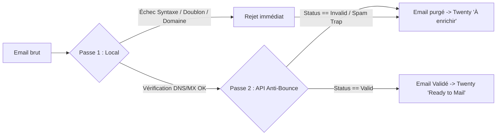

# Document de Conception Technique & Stratégique
# Campagne de Prospection Mailing & CRM Twenty — Contexte Lab

**Date :** 30 septembre 2026  
**Auteur :** Antigravity & Naoufel Chahid  
**Projet :** Enrichissement BDD, Intégration Twenty CRM & Campagne d'Acquisition Mailing Resend  
**Cible Principale :** Dirigeants d'entreprises (PDG, DG, Gérants, Top Management) au Maroc  
**Offre Mise en Avant :** Formation IA pour Dirigeants — [Contexte Lab](https://www.contextelab.ma)  

---

## 1. Contexte & Objectifs

### 1.1 Contexte de l'Entreprise
[Contexte Lab](https://www.contextelab.ma) est une agence d'IA pragmatique basée à Casablanca (Maroc), accompagnant les entreprises dans l'intégration maîtrisée de l'intelligence artificielle autour de 4 axes indépendants : Formation IA, Acquisition & Croissance, Données & IA, Automatisation & Agents IA.

Pour amorcer son acquisition commerciale B2B, Contexte Lab dispose de plusieurs bases de données de contacts (`bdd/BDD1` à `BDD6`) répertoriant plusieurs milliers d'entreprises et dirigeants marocains.

### 1.2 Objectifs Stratégiques & Contraintes
1. **Nettoyage & Sécurité Anti-Bounce** : Zéro tolérance pour les rebonds durs afin de préserver la délivrabilité. Tout email invalide doit être détecté et purgé avant ou dès détection.
2. **CRM Twenty comme Source Unique de Vérité** :
   - Ingestion progressive et structurée des entreprises et dirigeants.
   - Préservation des contacts même en l'absence d'email valide, avec application systématique du statut **`À enrichir`**.
   - Homogénéisation des 6 bases aux structures disparates.
3. **Protection & Isolation du Domaine Expéditeur** :
   - Domaine principal (`contextelab.ma`) réservé aux échanges directs et devis quotidiens.
   - Sous-domaine dédié d'envoi : `sales.contextelab.ma`.
   - Expéditeur : `Naoufel Chahid <chahid.naoufel@sales.contextelab.ma>`.
   - Réponse : `n.chahid@contextelab.ma`.
4. **Protocole de Warm-Up Prudent** :
   - Semaine 1 : Plafond strict de **100 emails par jour** pendant 7 jours (700 emails max la première semaine).
   - Débit horaire lissé (12 à 15 emails/h entre 9h et 17h30).
5. **Copywriting Engageant & A/B Testing Multi-Variantes** :
   - 5 templates axés sur la prise de conscience et le questionnement stratégique du dirigeant : *le futur de l'IA est déjà là, le rythme s'accélère, l'inaction menace la compétitivité, et la formation est le point de départ indispensable pour décider avec clarté*.

---

## 2. Analyse des Données Sources (`bdd/`) & Opportunités d'Enrichissement

### 2.1 Synthèse de l'Audit des Fichiers

| Fichier source | Volume total | Colonnes principales | Données téléphone | Taux Email | Spécificités & Potentiel d'Enrichissement |
| :--- | :--- | :--- | :--- | :--- | :--- |
| **`BDD1.xlsx`** | 5 049 lignes | Multi-contacts (jusqu'à 5 contacts/société), Raison Sociale, Activité, Ville, Adresse, Web, Capital, Effectif | Standard Fixe (90%), Fixe 2 (38%), GSM (0.9%), Fax (70%) | • Email 1 : 18.3% (923)<br>• Email 5 : 62.5% (3 158) | **4 267 dirigeants identifiés** avec nom, fonction, standard et ville, dont ~3 300 sans email direct : à injecter avec mention `À enrichir - Email manquant`. |
| **`BDD2.xlsx`** | 4 021 lignes | Multi-dirigeants (Contact 1 = PDG/DG à 82%, Dirigeant 2 à 5 = directeurs adjoints), Société (100%), Activité (100%), Ville (100%) | Tél 1 Fixe (91%), Tél 2 (45%), Fax (80%) | 78.1% (3 141 emails) | Excellente base pour qualifier 3 299 Dirigeants. Les emails rejetés basculent en `À enrichir`. |
| **`BDD3.xls`** | • Global : 801<br>• 2023 : 1 541<br>**Total : 2 342** | Société (99%), Civilité, Contact (99%), Statut/Fonction (96.9%), Ville, Adresse, base CFCIM qualifiée | • GSM Mobile (84% à 94%) !<br>• Fixe standard (89%) | • Global : 99.1% (794)<br>• 2023 : 94.3% (1 453) | **Fichier prioritaire haute valeur** : Présence conjointe du mobile portable (06/07), de l'email nominatif et du poste exécutif. |
| **`BDD4.xlsx`** | 482 lignes | EMPRESA, Nombre, Apellido, Actividad, Direccion, Localidad, Web | Fixe +212 5 (65.6%), Mobile +212 6 (56.2%) | 99.6% (480 emails) | Base zone Nord / Tanger très nette, distinction fixe/mobile et activité détaillée. |
| **`BDD5.xlsx`** | 15 548 lignes | FIRSTNAME, LASTNAME, JOB_TITLE, EMAIL | Aucun | 100% (15 548 emails) | Base nominative pure. 1 927 postes qualifiés. Entreprise et site web à déduire à partir du domaine de l'email pro. |
| **`BDD6.xls`** | 1 214 lignes | Société, Civilité, Contact, Fonction, TEL, Email | 99.5% (forte proportion de mobiles direct 06/07) | 100% (1 214 emails) | Forte présence de mobiles, à filtrer sur les fonctions de direction. |
| **`salaires_consolide.csv`** | 70 Mo | Données de paie | N/A | 0% | **Exclu** du périmètre mailing. |

### 2.2 Stratégie d'Enrichissement Post-Intégration
1. **Distinction Téléphonique** : Séparation stricte dans Twenty CRM entre le numéro **Standard / Fixe (05...)** et le **Mobile Direct / GSM (06... / 07...)**.
2. **Vivier d'Enrichissement "À enrichir"** : Tous les dirigeants identifiés dans `BDD1` et `BDD2` sans email valide (ou dont l'email a rebondi) sont créés dans le CRM avec leur entreprise, fonction et standard, marqués pour recherche d'email nominatif (LinkedIn Sales Navigator, Dropcontact).
3. **Secteur d'Activité** : Renseigné pour permettre des filtres d'enrichissement et d'accroche sectorielle.

---

## 3. Schéma Canonique & Couche d'Homogénéisation (ETL)

Un script Python dédié (`scripts/etl_normalize.py`) lit chaque fichier avec un adaptateur spécifique et produit des enregistrements normalisés selon le schéma pivot :

```python
canonical_schema = {
    # Données Entreprise
    "company_name": str,            # Raison sociale normalisée
    "activity_sector": str,         # Activité d'entreprise
    "website": str or None,         # URL propre ou extrait du domaine email
    "city": str,                    # Ville normalisée (Casablanca, Rabat, Tanger...)
    "address": str or None,         # Adresse postale
    "phone_standard": str or None,  # Numéro fixe (05...)
    "phone_mobile": str or None,    # Mobile direct (06... / 07... / +212 6...)
    
    # Données Contact
    "civility": str or None,        # M. / Mme
    "first_name": str,              # Prénom propre
    "last_name": str,               # Nom propre
    "job_title": str,               # Intitulé du poste
    "is_dirigeant": bool,           # Flag automatique basé sur le dictionnaire de direction
    
    # Données Mailing & Délivrabilité
    "raw_email": str or None,       # Email original
    "email": str or None,           # Email validé (ou None si invalide/supprimé)
    "email_validation_status": str, # 'DELIVRABLE', 'INVALID', 'BOUNCED', 'MISSING'
    
    # Gestion CRM & Enrichissement
    "source_file": str,             # Identifiant source (BDD1, BDD2, BDD3_Global, etc.)
    "enrichment_status": str,       # 'COMPLET', 'A_ENRICHIR_EMAIL_MANQUANT', 'A_ENRICHIR_EMAIL_INVALIDE'
    "missing_fields": list[str]     # Liste des attributs manquants
}
```

### 3.1 Dictionnaire de Qualification "Dirigeant"
Mots-clés regex : `\b(p\.?d\.?g\.?|directeur\s+général|directrice\s+générale|dg|gérant|gérante|président|présidente|fondateur|fondatrice|administrateur\s+délégué|administrateur\s+directeur\s+général|managing\s+director|ceo|directeur\s+associé|country\s+manager|directeur\s+exécutif)\b`.

---

## 4. Protocole Anti-Bounce & Nettoyage en 2 Passes



1. **Passe 1 : Hygiène Locale (Sans coût)** :
   - Validation syntaxique stricte (RFC 5322).
   - Dédoublonnage mondial sur toute la base (priorité au contact le plus richement documenté).
   - Rejet des domaines temporaires/jetables (blacklist).
   - Résolution DNS des enregistrements MX en Python (`dnspython`). Si aucun serveur de messagerie n'existe pour le domaine, l'adresse est déclarée invalide sans solliciter le réseau mail.
2. **Passe 2 : Contrôle Anti-Bounce API (ZeroBounce / Emailable)** :
   - Seules les adresses ayant passé la Passe 1 sont transmises.
   - Classification stricte :
     - `Valid` : Qualifié pour l'envoi.
     - `Invalid`, `Spam Trap`, `Abuse` : Rejetés. L'adresse email est effacée de la fiche contact, et le contact est enregistré dans `Twenty CRM` avec `enrichment_status = 'A_ENRICHIR_EMAIL_INVALIDE'`.
     - `Catch-All` : Mis en attente (exclus du warm-up initial).

---

## 5. Modélisation & Synchronisation Twenty CRM

### 5.1 Architecture Docker Twenty CRM
Le CRM Twenty déployé dans `/home/naoufel/projects/Enrich/twenty` (port `3005`) comprend :
- `server` : API Core Twenty (NestJS, REST & GraphQL)
- `worker` : Traitement d'arrière-plan et queues
- `db` : PostgreSQL 16
- `redis` : Cache et queues d'événements

### 5.2 Objets & Champs Personnalisés
* **Objet `Company` (`companies`)** :
  - `name` (Nom de la société)
  - `domainName` (Site web / nom de domaine)
  - `address` (Adresse complète)
  - `city` (Ville)
  - *Champ personnalisé* `activitySector` (Secteur d'activité)
  - *Champ personnalisé* `phoneStandard` (Téléphone standard fixe)
  - *Champ personnalisé* `enrichmentStatus` (Complet / À enrichir)

* **Objet `Person` (`people`)** :
  - `firstName`, `lastName`
  - `emails` : Adresse email vérifiée (champ **vide** si invalide/rebond)
  - `phones` : Mobile direct (GSM)
  - `jobTitle` : Fonction
  - `companyId` : Liaison avec la société
  - *Champ personnalisé* `isDirigeant` (Booléen)
  - *Champ personnalisé* `enrichmentStatus` :
    - `COMPLET`
    - `A_ENRICHIR_EMAIL_MANQUANT`
    - `A_ENRICHIR_EMAIL_INVALIDE`
    - `A_ENRICHIR_DONNEES_INCOMPLETES`
  - *Champ personnalisé* `campaignStatus` :
    - `READY_TO_MAIL`
    - `WARMUP_BATCH_1`
    - `EMAIL_SENT`
    - `EMAIL_DELIVERED`
    - `REPLIED`
    - `BOUNCED`
    - `UNSUBSCRIBED`
  - *Champ personnalisé* `templateVariant` (A, B, C, D, E)

### 5.3 Connecteur d'Ingestion
Le script `scripts/crm_sync.py` interroge l'API REST de Twenty CRM (`POST /rest/companies`, `POST /rest/people`) avec gestion des doublons par correspondance nom d'entreprise + domaine, et nom de famille + entreprise.

---

## 6. Infrastructure Délivrabilité Resend & Boucle Webhook

### 6.1 Configuration DNS du Sous-Domaine `sales.contextelab.ma`

| Type | Nom / Hôte | Cible / Valeur | Utilité |
| :--- | :--- | :--- | :--- |
| **TXT** | `sales` | `v=spf1 include:amazonses.com ~all` *(fourni par Resend)* | SPF : Autorisation d'émission pour Resend |
| **CNAME / TXT** | `resend._domainkey.sales` | *(Clé publique DKIM fournie par Resend)* | DKIM : Signature cryptographique des messages |
| **MX / CNAME** | `send.sales` | `feedback-smtp.us-east-1.amazonses.com` (priorité 10) | Return-Path : Gestion technique des retours |
| **TXT** | `_dmarc.sales` | `v=DMARC1; p=none; rua=mailto:dmarc@contextelab.ma;` | DMARC : Alignement et rapports de délivrabilité |

> **Règle impérative :** En cas d'utilisation de Cloudflare, tous ces enregistrements doivent être en mode **DNS Only (Nuage gris)**.

### 6.2 Récepteur Webhook (`scripts/webhook_listener.py`)
Un micro-service écoute les webhooks signés de Resend :
- `email.delivered` : Passage du contact à `campaignStatus = EMAIL_DELIVERED`.
- `email.bounced` (Rebond dur) :
  1. Suppression immédiate du mail dans Twenty CRM.
  2. Statut basculé à `enrichmentStatus = A_ENRICHIR_EMAIL_INVALIDE`, `campaignStatus = BOUNCED`.
  3. Ajout à la liste d'exclusion définitive locale (`suppression_list.json`).
- `email.complained` (Plainte spam) : Exclusion définitive du contact et de son domaine.

---

## 7. Stratégie Éditoriale & 5 Templates d'Emails (A/B Testing)

### 7.1 Ligne Directrice Psychologique & Narrative
* **L'Objectif de l'Accroche** : Instaurer un questionnement existentiel chez le dirigeant.
* **Le Constat** : L'IA n'est plus un sujet lointain ou optionnel. Le futur est déjà là, le rythme s'accélère à vive allure. Rester passif, c'est mécaniquement perdre en compétitivité face à des acteurs plus agiles.
* **Le Point de Départ** : L'acquisition d'outils au hasard est inefficace. **Le premier levier d'action est la formation** (comprendre le terrain, identifier les opportunités rentables, maîtriser les risques) afin de **décider avec clarté** de la feuille de route.

### 7.2 Les 5 Variantes de Templates

#### Variante A : Le Décalage de Compétitivité
* **Objet** : Votre entreprise face à l'accélération de l'IA au Maroc
* **Accroche** : « L'IA n'est plus une promesse pour 2030 : elle transforme déjà les marges et la vitesse d'exécution de nos entreprises. Dans ce contexte, l'inaction est devenue le choix le plus coûteux. »
* **Développement** : Comment savoir par où commencer sans se perdre dans la technique ? Le point de départ n'est pas d'acheter des logiciels, mais de donner à la direction les repères nécessaires pour décider en connaissance de cause.
* **Call to Action** : Question directe invitant à un retour par email.

#### Variante B : Le Futur est Déjà Là (L'Accélération du Rythme)
* **Objet** : IA : subir le rythme ou fixer la trajectoire ?
* **Accroche** : « Le rythme auquel l'IA s'installe dans nos métiers ne laisse plus le luxe d'attendre. Avez-vous aujourd'hui les repères pour arbitrer, ou laissez-vous le marché décider à votre place ? »
* **Développement** : Présentation du parcours Dirigeants de Contexte Lab : comprendre les cas d'usage réels, poser les garde-fous et piloter la transition sans dépendance technologique aveugle.
* **Call to Action** : Proposition d'un échange téléphonique de 10 minutes.

#### Variante C : L'Illusion du Temps (Contre l'Attentisme)
* **Objet** : Avons-nous encore le temps d'attendre sur l'IA ?
* **Accroche** : « Dans toutes les transitions technologiques majeures, le piège le plus fréquent est de croire qu'on a le temps de voir venir. Mais la courbe de l'IA n'est pas linéaire, elle est exponentielle. »
* **Développement** : Pour ne pas perdre la main face aux concurrents, le point d'ancrage le plus sain reste la montée en compétences stratégique. Savoir ce que l'IA peut faire pour [Nom de l'Entreprise], et surtout ce qu'elle ne doit pas faire.
* **Call to Action** : « Quel est votre sentiment sur le sujet ? Répondez simplement à cet email pour échanger. »

#### Variante D : De Dirigeant à Dirigeant (Casablanca)
* **Objet** : Échange entre dirigeants : intégrer l'IA avec pragmatisme
* **Accroche** : « En tant que dirigeant à Casablanca, je constate un décalage croissant : d'un côté, le bruit médiatique ; de l'autre, la réalité brute de nos entreprises où chaque investissement doit prouver son utilité. »
* **Développement** : Comment intégrer l'IA avant qu'elle ne devienne un handicap de compétitivité ? En commençant par former ceux qui décident. Un tour d'horizon sans jargon pour identifier vos 2 chantiers prioritaires.
* **Call to Action** : Invitation à un café ou un échange direct.

#### Variante E : Le Cadrage Décisionnel (La Clarté avant l'Action)
* **Objet** : Quel sujet IA mérite vos 30 prochaines minutes ?
* **Accroche** : « Si votre comité de direction devait arbitrer demain matin sur vos investissements IA, sauriez-vous exactement où se trouvent les gains de compétitivité et où sont les risques ? »
* **Développement** : Avant tout projet lourd, la formation apporte la lucidité : distinguer les vrais gains de productivité des simples gadgets. Vous décidez ensuite avec clarté de vos prochaines étapes.
* **Call to Action** : Lien vers la réservation d'un cadrage de 30 min ou réponse directe.

---

## 8. Moteur d'Envoi & Warm-Up Prudent (Semaine 1)

### 8.1 Planification d'Envoi
- **Plafond strict** : **100 emails par jour** pendant 7 jours consécutifs (700 emails total pour la Semaine 1).
- **Répartition des templates** : 20 contacts par template chaque jour (rotation équilibrée A, B, C, D, E).
- **Lissage horaire** : Un email expédié toutes les 4 à 5 minutes (soit ~12 à 15 emails/heure) entre 9h00 et 17h30.
- **Circuit Breaker** : Arrêt d'urgence si le taux de rebond dépasse 2% ou dès la première plainte spam.

### 8.2 Commandes d'Exploitation de l'Orchestrateur
- `python scripts/campaign_dispatcher.py --dry-run --batch 100` : Simulation complète, validation du lot et inspection visuelle des emails générés.
- `python scripts/campaign_dispatcher.py --send --batch 100` : Déclenchement de l'envoi contrôlé avec pause automatique et reprise sur incident.

---

## 9. Plan de Vérification & Métriques Clés

| Étape | Méthode de vérification | Critère de succès |
| :--- | :--- | :--- |
| **Audit & Normalisation ETL** | Exécution du script ETL sur `bdd/` | 100% des lignes mappées, aucune erreur fatale, fichier d'audit `audit_clean.csv` généré |
| **Anti-Bounce** | Résolution DNS locale + validation API | 0 email au statut `Invalid` injecté dans la file d'envoi |
| **Twenty CRM** | Inspection de l'API Twenty & interface web | Fiches créées, contacts avec emails invalides correctement tagués `À enrichir` sans champ email actif |
| **DNS `sales.contextelab.ma`** | Contrôle Resend Dashboard & `dns.email` | SPF, DKIM, Return-Path et DMARC validés (`PASS`) |
| **Simulation Envoi** | Commande `--dry-run` | 100 emails formatés, attribution correcte des templates A à E, pas d'anomalie de variable |
| **Métriques Campagne** | Dashboard Resend & Webhooks | Taux de rebond `< 1%`, Taux de plainte `< 0.02%`, Taux d'ouverture `> 25%` |
