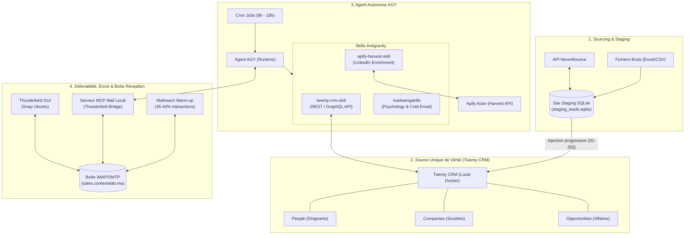
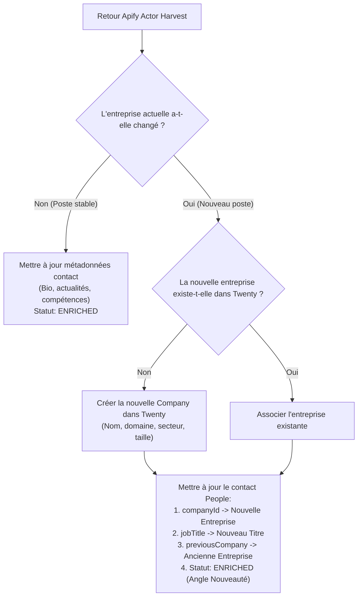

# Spécification de Conception : Architecture d'Outreach Autonome AGY, MCP Thunderbird & Twenty CRM

**Date :** 03 octobre 2026  
**Auteur :** Antigravity & Naoufel Chahid  
**Projet :** Système d'Acquisition B2B Autonome Infaillible (AGY Agent, MCP Mail, Twenty CRM, NeverBounce, Apify Harvest, Mailreach)  
**Cible Principale :** Dirigeants et décideurs B2B  
**Domaine d'envoi & messagerie :** Thunderbird local (`chahid.naoufel@sales.contextelab.ma`) avec warm-up Mailreach et fallback sécurisé  

---

## 1. Contexte, Motivation & Objectifs de la Refonte

### 1.1 Motivation de la Nouvelle Approche
Le modèle d'envoi précédent reposait sur des scripts d'expédition directe via Resend avec des modèles d'emails préformatés. Pour franchir un palier décisif en délivrabilité, pertinence et conversion, ce système évolue vers un **écosystème d'agent autonome cognitif** :
1. **Fin des scripts d'envoi aveugles** : L'envoi est confié à l'agent `agy` opérant via un serveur MCP connecté au client de messagerie local (Thunderbird).
2. **Fin des templates rigides** : L'agent rédige un email 100% sur-mesure pour chaque prospect, basé sur des données fraîches de carrière (LinkedIn / Apify Harvest) et guidé par des compétences de psychologie marketing et copywriting.
3. **Protection absolue du domaine et zéro bounce** :
   - Audit systématique par l'API **NeverBounce** au sas d'entrée.
   - Suppression immédiate des emails à risque avec bascule en statut `NEEDS_ENRICHMENT`.
   - Warm-up continu avec **Mailreach** sur 3 semaines.
   - Coupe-circuit immédiat si un rebond réel survient.
4. **CRM Twenty préservé et dynamique** :
   - Alimentation progressive via un sas de staging local (pas d'injection massive de milliers de lignes brutes d'un coup).
   - Détection proactive des changements de poste : si un contact change d'entreprise, création de la nouvelle société et mise à jour de la relation dans Twenty.
   - Gestion de l'inbound : qualification automatique des réponses en opportunités commerciales dans Twenty.

---

## 2. Architecture Globale du Système



---

## 3. Sas de Staging & Validation NeverBounce Infaillible

### 3.1 Base de Staging Locale (`staging_leads.sqlite`)
Afin d'éviter de saturer Twenty CRM avec des données non qualifiées ou des emails invalides, les imports bruts sont confinés dans une base SQLite intermédiaire :

```sql
CREATE TABLE IF NOT EXISTS staging_leads (
    id INTEGER PRIMARY KEY AUTOINCREMENT,
    source_file TEXT NOT NULL,
    first_name TEXT,
    last_name TEXT,
    company_name TEXT,
    job_title TEXT,
    phone_standard TEXT,
    phone_mobile TEXT,
    raw_email TEXT,
    clean_email TEXT,
    linkedin_url TEXT,
    neverbounce_status TEXT DEFAULT 'PENDING', -- PENDING, VALID, INVALID, DISPOSABLE, CATCHALL, UNKNOWN
    enrichment_status TEXT DEFAULT 'PENDING',  -- READY_FOR_CRM, NEEDS_ENRICHMENT, ENRICHED, UNREACHABLE
    priority_score INTEGER DEFAULT 0,
    crm_person_id TEXT,
    crm_synced_at TIMESTAMP,
    created_at TIMESTAMP DEFAULT CURRENT_TIMESTAMP
);
```

### 3.2 Règles Métier NeverBounce
1. **Statut `valid`** :
   - `clean_email = raw_email`.
   - `neverbounce_status = 'VALID'`.
   - `enrichment_status = 'READY_FOR_CRM'`.
2. **Statut `invalid` ou `disposable` (Risque de bounce immédiat)** :
   - `clean_email = NULL` (suppression stricte de l'adresse pour empêcher tout routage).
   - `neverbounce_status = 'INVALID'`.
   - `enrichment_status = 'NEEDS_ENRICHMENT'` (le contact est conservé pour recherche ultérieure d'email pro via Apify / Harvest).
3. **Statut `catchall` / `unknown`** :
   - Exclus des micro-envois prioritaires de la Semaine 1 pour protéger la réputation du domaine.

### 3.3 Stratégie d'Injection Progressive dans Twenty
- L'agent AGY ou le script de synchronisation n'injecte que **20 à 30 contacts prioritaires par jour ouvré** depuis `staging_leads` vers Twenty CRM.
- **Formule de Scoring de Priorité (`priority_score`)** :
  - Dirigeant exécutif (PDG, DG, Fondateur, Gérant) : **+100 points**
  - Directeur de département (Marketing, Commercial, Technique) : **+70 points**
  - Email validé NeverBounce : **+50 points**
  - Téléphone portable GSM identifié (06/07) : **+30 points**
  - Profil LinkedIn renseigné : **+20 points**

---

## 4. Enrichissement Apify (Actor Harvest) & Cycle de Vie Twenty CRM

### 4.1 Intégration Apify Actor Harvest
L'agent AGY dispose de la compétence `apify-harvest-skill`. Lorsqu'un prospect nécessite un enrichissement ou des signaux frais de personnalisation, l'agent déclenche l'exécution de l'Actor Apify Harvest :
- **Entrées** : URL LinkedIn du profil ou combinaison `{prénom, nom, entreprise, ville}`.
- **Sorties exploitées** :
  - Intitulé de poste actuel et date de prise de poste (`current_job_start_date`).
  - Entreprise actuelle (`current_company_name`, site web, taille, industrie).
  - Historique de carrière (`past_companies`).
  - Activité récente (derniers posts, interactions publiques).

### 4.2 Gestion Proactive des Changements de Carrière
Lors du traitement du résultat Apify, l'agent applique le protocole d'hygiène suivant dans Twenty CRM :



- **Valeur pour la prospection** : La transition professionnelle devient l'accroche n°1 du cold email (ex: félicitations pour la prise de rôle récent chez la nouvelle entreprise).

---

## 5. Moteur de Rédaction Cognitive & Skills Marketing

### 5.1 Compétences Marketing Embarquées (`marketingskills`)
L'agent AGY charge les directives de copywriting B2B et de psychologie commerciale (inspirées de `coreyhaines31/marketingskills`) :
- **Module `cold-email`** :
  - Format 100% texte brut (**Zero HTML**, pas d'images, pas de liens complexes).
  - Longueur cible : **50 à 85 mots**.
  - Objet ultra-court (2 à 4 mots, ton conversationnel naturel : ex: *« question sur [Entreprise] »*).
  - Call-to-action unique et léger (invitation à échanger 5 min).
- **Module `marketing-psychology`** :
  - Principe de pertinence aiguë : parler des enjeux propres à sa fonction et à son secteur.
  - Preuve sociale discrète adaptée au marché local marocain (Contexte Lab, Casablanca).
- **Module `copywriting`** :
  - Phrases courtes, dynamiques, clarté absolue, suppression de tout jargon commercial pompeux.

### 5.2 Règle d'Unicité Infaillible
L'agent génère chaque message de façon unitaire à la volée. Aucun message n'est la copie exacte d'un autre, ce qui évite la détection de séquences massives par les algorithmes anti-spam de Google et Microsoft.

---

## 6. Serveur MCP Mail Local & Synergie Warm-up Mailreach

### 6.1 Rôle et Intégration du Serveur MCP Mail
Le serveur MCP Mail local fait office de passerelle entre l'agent `agy` et la messagerie locale :
- **Outils exposés à l'agent** :
  - `send_email(to, subject, body_text, reply_to)` : Envoie l'email unitaire via les paramètres SMTP locaux avec les en-têtes conformes Thunderbird.
  - `archive_sent_email(...)` : Copie automatiquement le message envoyé dans le dossier `Sent` (Messages envoyés) de Thunderbird.
  - `list_inbox_messages(unread_only, since_date)` : Liste les messages reçus dans la boîte.
  - `get_message_details(message_id)` : Lit le contenu brut pour analyse.
  - `move_message(message_id, folder_name)` : Classe les messages (ex: déplacement des bounces vers `Bounces_Archives`).
- **Indépendance vis-à-vis du bac à sable Snap** : Le serveur MCP dialogue directement avec le protocole de messagerie local (IMAP/SMTP local sécurisé), éliminant tout blocage AppArmor ou fermeture intempestive de la fenêtre Thunderbird.

### 6.2 Coordination avec Mailreach
- **Protocole sur 3 semaines** :
  - *Semaine 1* : 15 à 25 interactions Mailreach/jour + **5 emails réels/jour**.
  - *Semaine 2* : 25 interactions Mailreach/jour + **15 emails réels/jour**.
  - *Semaine 3* : 20 interactions Mailreach/jour + **30 à 50 emails réels/jour**.
- **Synchronisation journalière** :
  - 8h30 - 9h30 : Les messages de warm-up Mailreach réchauffent la boîte.
  - 9h30 - 17h00 : L'agent AGY délivre les 5 emails réels de manière espacée (1 envoi toutes les 45 à 75 minutes, avec délai aléatoire).

---

## 7. Surveillance Inbound, Qualification & Coupe-Circuit Infaillible

### 7.1 Analyse Automatique Inbound
L'agent examine périodiquement la boîte de réception et trie les messages :

| Typologie reçue | Détection Sémantique par l'Agent | Action Twenty CRM | Action Messagerie |
| :--- | :--- | :--- | :--- |
| **Bounce / NDR** | Présence de `Mailer-Daemon`, codes 550, `User unknown`, `Delivery Status Notification` | `campaignStatus = 'BOUNCED'`<br>Suppression de l'email du contact<br>`enrichmentStatus = 'NEEDS_ENRICHMENT'` | Déplacement vers `Bounces_Archives`<br>**Déclenchement du Coupe-Circuit** |
| **Réponse Positive** | Détection d'intérêt, demande de devis, question tarifaire, accord pour un rendez-vous | Création d'une **Opportunité** liée au contact et à sa société (Stage: *Qualified / RDV*)<br>Ajout d'une note de synthèse | Déplacement vers dossier `Opportunités`<br>Alerte prioritaire pour prise en main humaine |
| **Désabonnement / Refus** | Mots-clés : « Stop », « Ne plus me contacter », « Pas intéressé » | `campaignStatus = 'UNSUBSCRIBED'` | Déplacement vers dossier `Désinscrits` |

### 7.2 Coupe-Circuit de Sécurité (Circuit Breaker)
- Si **1 seul bounce réel** survient au cours de la journée :
  - L'agent gèle immédiatement tout envoi programmé pour le reste de la journée.
  - Notification d'alerte émise.
  - Audit automatique pour identifier la faille (ex: contact ancien n'ayant pas transité par NeverBounce).
  - Reprise uniquement après validation humaine.

---

## 8. Orchestration Journalière (Cron Jobs)

L'agent est cadencé par cron aux jours ouvrés :

```cron
# 09:00 - Revue de la boîte, analyse des retours de la nuit, sélection des 5 cibles et enrichissement Apify
0 9 * * 1-5 /home/naoufel/projects/Enrich/scripts/cron_agent_dispatcher.sh --task prepare_daily_batch

# 10:00, 11:30, 14:00, 15:30, 17:00 - Envois unitaires espacés avec gigue aléatoire (Jitter)
0 10,14,17 * * 1-5 /home/naoufel/projects/Enrich/scripts/cron_agent_dispatcher.sh --task send_next_candidate
30 11,15 * * 1-5 /home/naoufel/projects/Enrich/scripts/cron_agent_dispatcher.sh --task send_next_candidate

# 18:00 - Traitement inbound final, rapport de réputation et synchronisation CRM
0 18 * * 1-5 /home/naoufel/projects/Enrich/scripts/cron_agent_dispatcher.sh --task review_inbox_and_sync
```

---

## 9. Plan de Mise en Œuvre Découpé (Phases Suivantes)

La mise en œuvre sera structurée lors de la phase de planification (`writing-plans`) selon les modules indépendants suivants :

1. **Module 1 : Sas de Staging SQLite & Client NeverBounce** (`staging_db.py`, `neverbounce_client.py`).
2. **Module 2 : Skill & Client Apify Harvest** (`apify_harvest_client.py`, gestion des mouvements de postes dans `twenty_client.py`).
3. **Module 3 : Compétence Marketing & Prompt Engine** (`skills/marketingskills/` pour cold-email, copywriting et psychologie).
4. **Module 4 : Serveur MCP Mail Local** (Bridge IMAP/SMTP local compatible Thunderbird).
5. **Module 5 : Dispatcher Autonome & Runner Cron** (`cron_agent_dispatcher.sh`, orchestration, coupe-circuit).
